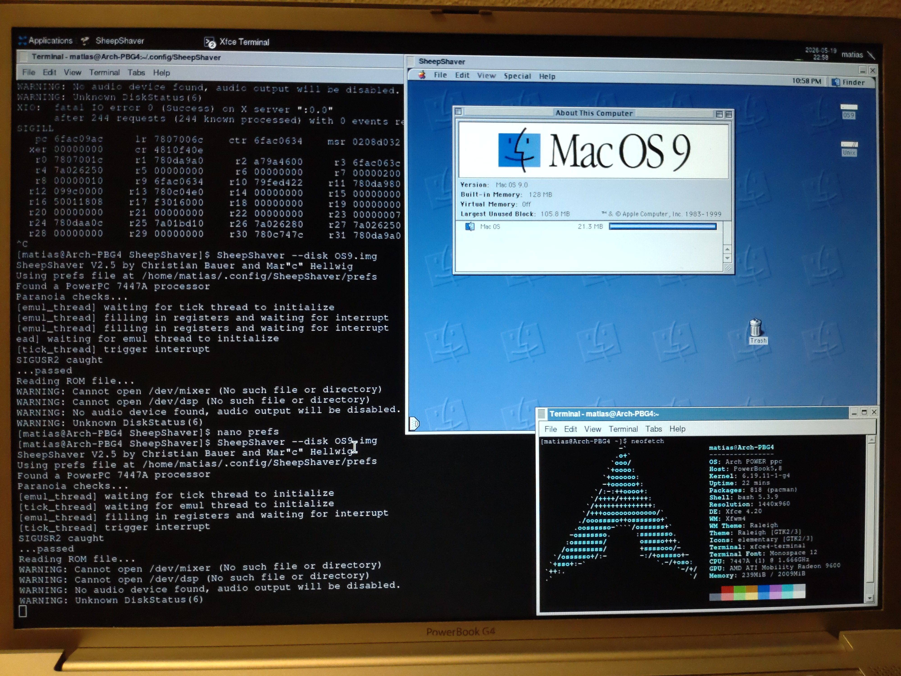
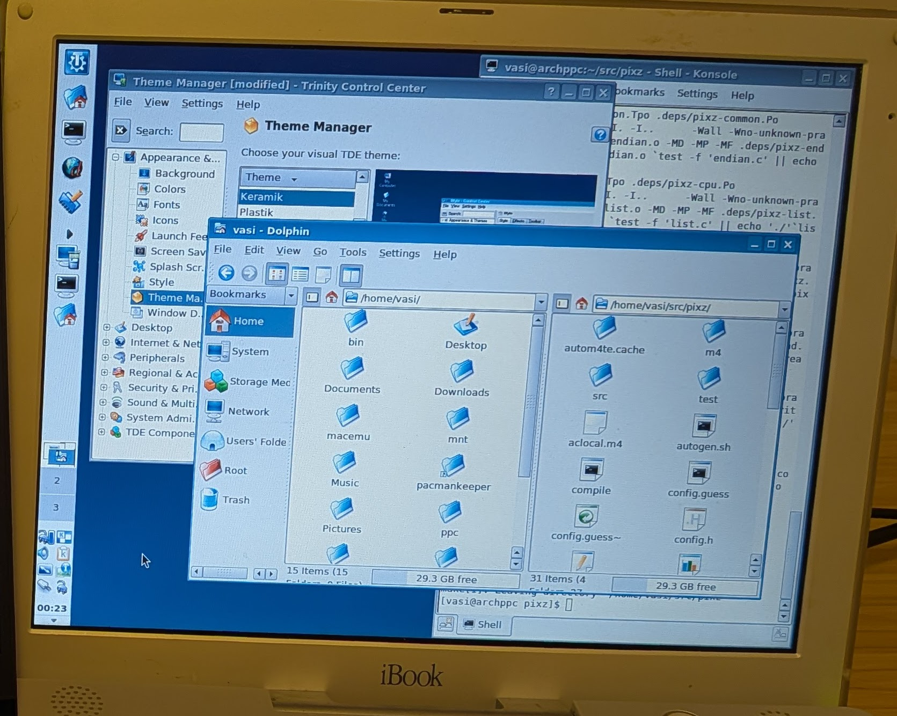

# vasi's iBook retrocomputing adventures

I bought an [iBook G3 "Snow"](https://everymac.com/systems/apple/ibook/specs/ibook_500.html) on eBay to play with, and tried a bunch of weird things!

# Highlights

* [Got fixes into the Linux kernel and GRUB](#important-patches-accepted-upstream)
* [Built a multi-OS boot chooser](https://github.com/vasi/ofchooser), with custom keyboard shortcuts and room for as many OSes as you want.
* [Revived SheepShaver's native PowerPC mode](https://github.com/kanjitalk755/macemu/pull/302), running Mac OS 9 at native speeds on PowerPC Linux after over a decade of bit rot.
* [Packaged software that makes this old Mac useful](#arch-power-package-repo), from a full office suite to Docker-compatible containers.
* [Booted Arch POWER without repartitioning](https://github.com/vasi/hfswrap), using a loopback boot device and some cursed boot hooks.
* [Rescued old PowerPC Linux releases](#software-preservation), including several versions of Yellow Dog Linux.

# Table of contents

* [Highlights](#highlights)
* [Machine and setup](#machine-and-setup)
  * [Hardware](#hardware)
  * [Operating systems](#operating-systems)
* [My projects](#my-projects)
  * [Projects I substantially built](#projects-i-substantially-built)
  * [Important patches, accepted upstream](#important-patches-accepted-upstream)
  * [Arch POWER package repo](#arch-power-package-repo)
* [Software I've tried](#software-ive-tried)
  * [Web browsers](#web-browsers)
  * [System tools](#system-tools)
  * [Desktop](#desktop)
* [Software preservation](#software-preservation)

# Machine and setup

## Hardware

* Model: PowerBook4,1 M6497
* CPU: 500 MHz [PowerPC](https://en.wikipedia.org/wiki/PowerPC) G3
  * That's not x86, it's a whole other architecture. What you think of as normal operating systems and software don't run here!
  * Somehow runs even slower than I expected. Maybe a slow bus, or bad cache?
* RAM: 640 MB PC133
* GPU: ATI Rage Mobility 128
* Disk: 15 GB 4200 RPM
  * Slow and small, and [so hard to replace](https://www.ifixit.com/Guide/iBook+G3+12-Inch+Hard+Drive+Replacement/131)
  * I'm using a dual USB2/Firewire enclosure with an SSD for most purposes

## Operating systems

The main OSes I've tried:

* Mac OS 9
* Mac OS X 10.4 Tiger
* Linux
  * [Arch POWER](https://archlinuxpower.org/), which has quickly become my favourite. It includes prebuilt packages of things like web browsers and desktop environments, and because it's Arch-based, it's easy to mod and build new packages for.
  * [Yellow Dog Linux 5.0](https://en.wikipedia.org/wiki/Yellow_Dog_Linux)
  * Debian sid (from ports)
* [Open Firmware](https://en.wikipedia.org/wiki/Open_Firmware): Not quite an operating system, but it's the [Forth](https://en.wikipedia.org/wiki/Forth_(programming_language)) environment that serves as the firmware on most PowerPC Macs. I'm playing around with writing code for it.

I've also tested booting a few random things:

* FreeBSD, OpenBSD, NetBSD
* [Adélie Linux](https://www.adelielinux.org/)
* Lubuntu 16.04
* Netbooting: OS 9, Tiger, and even Arch POWER

# My projects

## Projects I substantially built

* [ofchooser](https://github.com/vasi/ofchooser): A first-stage bootloader for multiple OSes on PPC Macs. Like [yaboot](https://en.wikipedia.org/wiki/Yaboot), but lets you choose from as many OSes as you want, and set your own keyboard shortcuts.
*  [SheepShaver support for PowerPC Linux](https://github.com/kanjitalk755/macemu/pull/302): The SheepShaver emulator was originally designed to run Mac OS 9 on other PowerPC operating systems such as BeOS, at full speed on the native CPU. But nobody has run it in that mode for a long time, perhaps as much as 13 years! I did some archeology, and got it working again on Arch Power.
* [pacmankeeper](https://github.com/vasi/pacmankeeper): A rudimentary [declarative package management](https://github.com/vasi/declarative-package-management) tool for Arch. Allows you to just declare what packages you actually want, and remove all the cruft you don't need.
* [hfswrap](https://github.com/vasi/hfswrap): A crazy hack to boot Arch Power on a PowerPC Mac, without partitioning your disk. Uses a loopback boot device, and some cursed boot hooks.
* [A guide to cross-compiling for Arch Power](https://gist.github.com/vasi/1a1de8cac794a6c3896f6531717b6147): Old Macs are _slow_ and single-processor, building modern software can take _forever_. It's better to build Arch packages in a custom VM on fast hardware, preferably with [distributed icecream compilation nodes](https://github.com/icecc/icecream). It's not easy to set up, but this guide explains how.

## Important patches, accepted upstream

* Linux kernel patches:
  * [Prevent boot failures on most 32-bit PPC machines](https://github.com/torvalds/linux/commit/31daa34315d45d3fe77f2158d889d523d78852ea)
  * [Fix the mprotect syscall on 32-bit PPC](https://github.com/torvalds/linux/commit/78fc63ffa7813e33681839bb33826c24195f0eb7)
* [Grub](https://en.wikipedia.org/wiki/GNU_GRUB) bootloader:
  * [Fix HFS+ filesystem when there's many files, and file IDs are greater than 31 bits](https://gitlab.freedesktop.org/gnu-grub/grub/-/commit/4af0504b724b89d7e8057e64a6260a4d04781ffd)
  * [Allow reading HFS+ files created by Mac OS 9](https://gitlab.freedesktop.org/gnu-grub/grub/-/commit/a8379e693b00ed523aac96230c778c773fcbb684)
* Arch POWER:
  * [Enable Airport wireless support in kernel](https://github.com/kth5/archpower/commit/91be0d5de8af82428742a9afb0c9f8c7ba8e8873)
  * [Fix cross-build of toolchain](https://github.com/kth5/archpower/commit/b7fa9abca64b04428873cffea6dee0e4c57b880b), and [again](https://github.com/kth5/archpower/commit/490d73b492eb348ca874d70f9561a00c431a55d8)
  * [Figure out how to get Rage 128 GPU working](https://github.com/kth5/archpower/pull/123)
  * [Fix SDL build for 32-bit PPC](https://github.com/kth5/archpower/commit/982c574a714a06a45790df207f9be8ba8abbf591)

## Arch POWER package repo

I've [created a repository of my own packages for Arch POWER](https://github.com/vasi/archpower-packages).

Some highlights:

* [KOffice](https://en.wikipedia.org/wiki/KOffice): The Trinity version, which is lightweight enough to actually run. A full word processor, spreadsheet and presentation builder, including support for modern file formats like [docx](https://en.wikipedia.org/wiki/Office_Open_XML).
* [Charliecloud](https://charliecloud.io/): A Docker-compatible container implementation. I added some patches so it can run on PPC32.
* [Ted](https://ftp.nluug.nl/pub/editors/ted/): A lightweight word processor, that not only runs, but runs _well_.
* [skippy-xd](https://github.com/richardgv/skippy-xd): Shows all windows on your desktop, like [macOS Exposé](https://en.wikipedia.org/wiki/Mission_Control_(macOS)) for lightweight Linux desktops.
* [Kobo Deluxe](https://www.olofson.net/kobodl/): One of the few games that's fast, fun, and not terribly ugly.
* [MATE](https://mate-desktop.org/): The entire lightweight desktop!

# Software I've tried

I've tried lots of projects that other people built. Here are some I particularly liked, that weren't already mentioned above:

## Web browsers

The browsers available on such an old machine are very limited, so I did testing and noted what worked well for me:

OS 9:

* [MacSurf](https://macsurf.org/) is new, and works _fine_, but can't view most modern sites.
* IE 5 and Classilla aren't especially useful nowadays

Tiger:

* [AquaWeb Plus](https://forums.macrumors.com/threads/aquaweb-plus-a-high-performance-minibrowser-for-low-end-macs.2202825/) with a modern [Aquafox](https://blackbirdlc.github.io/aquafox/Homepage.html) gives the best experience.
* [links2](https://links.twibright.com/) from [tigerbrew](https://github.com/mistydemeo/tigerbrew) works on fewer sites, but is much faster. Graphical mode (`-g`) looks pretty ok.
* Also ok: InterWebPPC, DarkWeb, PowerFox, RetroZilla

Arch POWER:

* [Phantom Satellite](https://github.com/DCFUKSURMOM/Phantom-Satellite) works the best
* links2 and dillo are fast, if limited
* Also ok: Basilisk, ArcticFox, SeaLion

It's not a browser itself, but [Browservice](https://github.com/ttalvitie/browservice) is also great. It runs a modern browser engine on a Raspberry Pi, and exports a UI that's usable by historical browsers like Safari or Firefox 1.0.

## System tools

* [netatalk](https://netatalk.io/), which allows Mac OS 9/X to share files with a modern Linux computer.
* [Realtek wireless drivers on Linux](https://wireless.docs.kernel.org/en/latest/en/users/drivers/rtl819x.html): Even though the machine only has an obsolete WEP chip, I can use a little USB wireless dongle and connect via WPA.
* [tigerbrew](https://github.com/mistydemeo/tigerbrew): A package manager for Mac OS 10.4, including some prebuilt packages.

## Desktop

*  [Trinity Desktop](https://www.trinitydesktop.org/): A fork of KDE 3, still maintained and updated. Has support for many odd things that modern desktops don't, such as battery-level indicators for PowerPC Macs.
* [Kate](https://kate-editor.org/), the KDE code editor. You can run a modern [LSP](https://en.wikipedia.org/wiki/Language_Server_Protocol) for programming language support, on a 25-year-old laptop!
* [JWM](https://joewing.net/projects/jwm/): A hyper-lightweight X11 window manager. It's fast, but still quite functional, and very configurable. I've set it up with:
  * [Window snapping](https://en.wikipedia.org/wiki/Snap_%28computer_graphics%29) to screen edges, as in Windows, which just needs turning on some config knobs.
  * [jgmenu](https://github.com/jgmenu/jgmenu): A searchable launcher
  * [Scripts](https://gist.github.com/vasi/3457a2bc9d7de1ca472f9d6eb6b2003e) using [YAD](https://github.com/step-/yad) to provide systray icons for battery status and volume, including support for the laptop's volume keys

# Software preservation

Some software for old hardware isn't well-archived, so I've added:

* [pdisk](https://github.com/vasi/pdisk): The [Apple Partition Map](https://en.wikipedia.org/wiki/Apple_Partition_Map) partition editor has forks for lots of different OSes, but often buggy and hard to build. This repo fixes some bugs, and makes it buildable on modern Linux.
* [pbbuttons](https://github.com/vasi/pbbuttons): Software for power management and special keys on old Mac laptops in Linux. Source was available, but needed patches, and import to git.
* [Linux distros on Archive.org](https://archive.org/details/@djvasi). I found bits and pieces on obscure sites, and put them somewhere they'll stay safe:
  * [Several rescued versions](https://archive.org/details/yellowdog-ftp-root) of [Yellow Dog Linux](https://en.wikipedia.org/wiki/Yellow_Dog_Linux). Includes installer ISOs, and package repositories.
  * [Lubuntu 16.04 PPC alternate installer](https://archive.org/details/lubuntu-16.04-alternate-powerpc), which is easier to install on low-RAM systems.
  * [Mandriva 2005 PPC installer](https://archive.org/details/mandriva-linux-2005-limited-edition-ppc)

